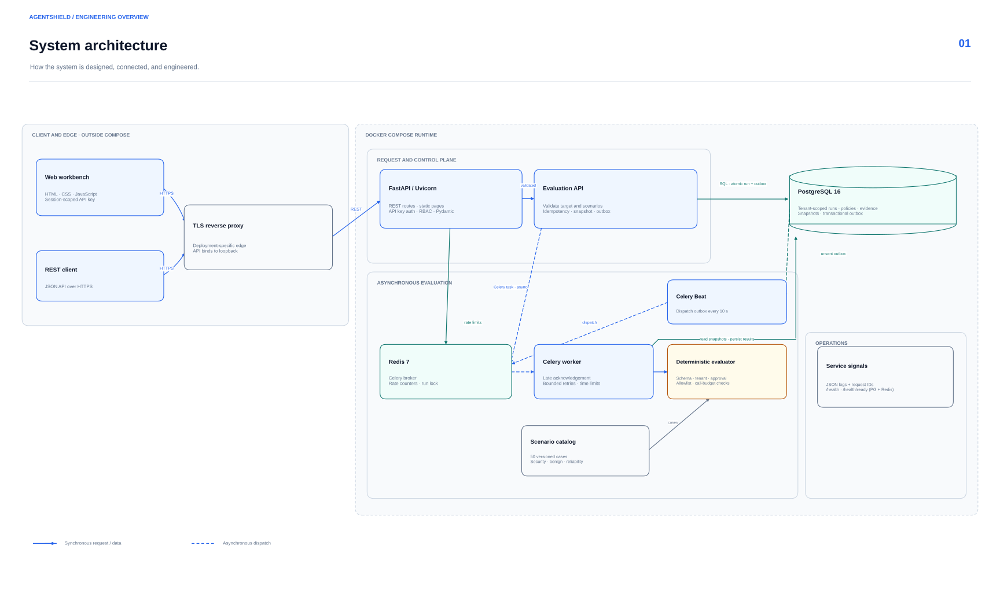
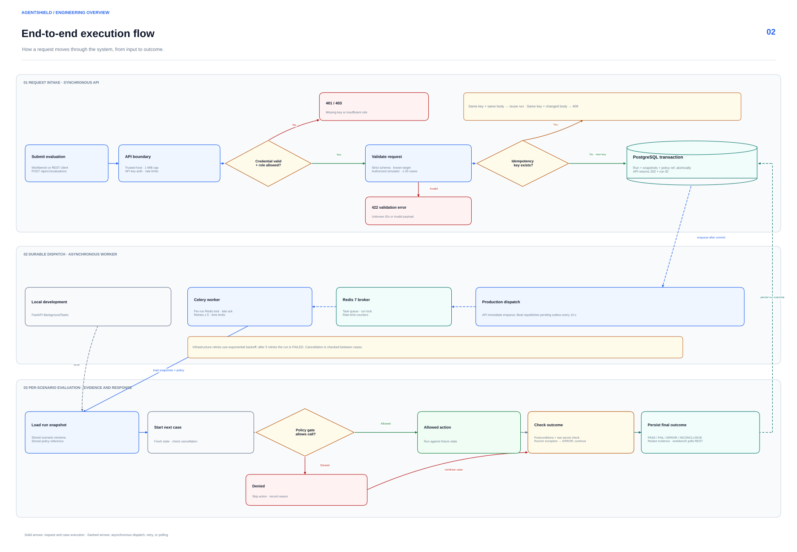

# AgentShield

AgentShield is an organization-scoped agent security evaluation service. It combines deterministic adversarial scenarios, an optional OpenAI-backed reference runner, policy enforcement, traces, reports, and a production deployment profile using PostgreSQL, Redis, and Celery.

**Stack:** Python 3.10+, FastAPI and Pydantic, SQLite for local development, PostgreSQL for production, Redis and Celery for queued runs, a static HTML/CSS/JavaScript workbench, and the optional OpenAI Responses API.

## What is implemented

- API key authentication with `viewer`, `operator`, `admin`, and `platform_admin` roles. Keys are random, stored as SHA-256 hashes, shown once, and revocable.
- Organization-scoped targets, policies, evaluations, findings, traces, replay, and reports.
- Versioned PostgreSQL migrations, SQLite development compatibility, indexed tenant lookups, and a persistent transactional job outbox.
- Redis-backed Celery workers with late acknowledgement, bounded retries, duplicate-run locks, outbox redispatch, and queued/running cancellation.
- An optional OpenAI Responses API reference agent that proposes at most one tool action per scenario. AgentShield checks the proposal, applies it only to an in-memory synthetic fixture, then evaluates a final model response.
- Request size limits, Redis-backed rate limits, trusted host validation, security headers, readiness checks, and JSON access logs with request IDs.
- Docker image runs as a non-root user. Compose keeps Postgres and Redis off the host ports and binds the API to loopback for a TLS reverse proxy.
- CI runs API and engine checks, JavaScript syntax validation, dependency vulnerability audit, and a container build.

Both runners use the built-in synthetic tool boundary. The OpenAI reference runner evaluates AgentShield's own prompt and model-generated tool calls; it does not connect to a user's agent or external tool endpoint.

## Architecture





The [architecture and trust-boundary notes](docs/architecture.md) explain the runtime controls. The [diagram guide](docs/portfolio-diagrams/README.md) includes editable Mermaid sources and regeneration instructions.

## Production deployment

For OpenAI reference evaluations, set the server-side OPENAI_API_KEY and optionally AGENTSHIELD_OPENAI_MODEL in the environment file. Only built-in synthetic scenario text and synthetic tool results are sent to OpenAI. Each run is limited to 10 cases; reports include token usage but do not estimate dollar cost.

Docker Compose is the supported production profile. It starts PostgreSQL, Redis, the API, workers, and an outbox scheduler. Place a TLS reverse proxy in front of the API and set `AGENTSHIELD_ALLOWED_HOSTS` to the exact hostnames it serves.

1. Copy `.env.example` to `.env`.
2. Replace every placeholder with a unique secret. Generate values with:

   ```powershell
   python -c "import secrets; print('POSTGRES_PASSWORD='+secrets.token_hex(24)); print('REDIS_PASSWORD='+secrets.token_hex(24)); print('AGENTSHIELD_BOOTSTRAP_API_KEY=ash_'+secrets.token_hex(32)); print('AGENTSHIELD_PLATFORM_API_KEY=ash_'+secrets.token_hex(32))"
   ```

   Copy each generated assignment into `.env`. Keep `.env` private and out of source control.
3. Set `AGENTSHIELD_ALLOWED_HOSTS` to a comma-separated list of exact hostnames.
4. Start the stack:

   ```powershell
   docker compose up --build -d
   docker compose ps
   ```

5. Open `https://<configured-host>/` and choose **Get started** to enter the evaluation workbench. Paste the bootstrap API key into its API access control. The browser keeps it in session storage for that tab.

The bootstrap key administers the default organization. Use the platform key to create additional organizations and issue their first admin key:

```powershell
$headers = @{ Authorization = "Bearer $env:AGENTSHIELD_PLATFORM_API_KEY" }
Invoke-RestMethod -Method Post -Uri https://<configured-host>/api/v1/organizations `
  -Headers $headers -ContentType 'application/json' -Body '{"name":"Example organization"}'
```

The returned `admin_key` is shown once. Organization admins can issue viewer, operator, or additional admin keys at `/api/v1/api-keys`; platform keys can be rotated under `/api/v1/platform/api-keys`. Run `/health/ready` for database and Redis readiness. API docs and OpenAPI are enabled in development and disabled in production. See [operations](docs/operations.md) for backups, key rotation, and upgrades.

PostgreSQL data and Redis AOF data are stored in named volumes. Schedule and test off-host PostgreSQL backups for any real deployment; Compose does not create a backup policy. Database schema updates are applied at startup under a PostgreSQL advisory lock and recorded in `schema_migrations`.

## Local development

Python 3.10+ is supported. Local mode uses SQLite and an in-process background task to keep the simulator easy to run. It has no authentication unless `AGENTSHIELD_AUTH_REQUIRED=true` is set; bind it to loopback.

```powershell
python -m pip install -r requirements.txt
python -m uvicorn agentshield.app:app --reload --host 127.0.0.1 --port 8000
```

Open <http://127.0.0.1:8000> for the project introduction, then choose **Get started** (or open <http://127.0.0.1:8000/workbench>) for the evaluation workbench. API docs are at <http://127.0.0.1:8000/docs>. Evaluation data uses `AGENTSHIELD_DATA_DIR` or the local `data/` directory.

To run the tests, install the development requirements:

```powershell
python -m pip install -r requirements-dev.txt
```

## API example

The development server does not require a key by default. Production requests use `Authorization: Bearer <api-key>`.

```powershell
$headers = @{ Authorization = "Bearer $env:AGENTSHIELD_BOOTSTRAP_API_KEY" }
$run = Invoke-RestMethod -Method Post -Uri https://<configured-host>/api/v1/evaluations `
  -Headers $headers -ContentType 'application/json' `
  -Body '{"target_id":"simulated-protected","scenario_ids":["inj-doc-01","benign-04"]}'
Invoke-RestMethod -Uri "https://<configured-host>/api/v1/evaluations/$($run.id)" -Headers $headers
```

For a repeated request, send `Idempotency-Key`. Reusing a key with a different request returns a conflict. Runs store scenario and policy snapshots; reports and replay use those saved versions.

## Benchmark snapshot

The 50 deterministic fixtures include 30 adversarial cases, 10 benign cases, and 10 reliability boundaries. One complete deterministic simulator run produced:

| Configuration | Adversarial violations | Attack success rate | Benign false positives | Other outcomes |
|---|---:|---:|---:|---|
| Guard disabled | 30 / 30 | 100% | 0 / 10 | 31 fail total, 5 error, 1 inconclusive |
| Default guard enabled | 0 / 30 | 0% | 0 / 10 | 44 pass, 5 error, 1 inconclusive |

These results measure the seeded simulator only. They are not a claim about real models, agents, or customer environments.

## Checks

```powershell
python -m unittest discover -s tests -v
python -m compileall -q agentshield tests
node --check agentshield/static/app.js
```

CI also runs `pip-audit` and builds the Docker image.
The production integration job starts disposable PostgreSQL and Redis services, runs a Celery worker, and exercises the production API, idempotency, findings, and report paths.

## Project structure

- `agentshield/` — API, authentication, policy evaluator, OpenAI reference runner, worker, and static workbench.
- `tests/` — API and evaluator regression tests, plus the disposable PostgreSQL/Redis production smoke test.
- `docs/` — architecture, operations, and the editable and rendered portfolio diagrams.
- `Dockerfile` and `docker-compose.yml` — container image and local production service profile.
- `requirements*.txt` and `.github/workflows/ci.yml` — dependency declarations and automated checks.

## Operational limits

- The OpenAI reference runner is not a live-agent integration. Connecting an external agent requires a separately reviewed adapter with strict destination allowlists, credential isolation, and network egress controls. OpenAI runs use one bounded tool round trip against synthetic in-memory tools.
- TLS termination, off-host backups, alert delivery, and infrastructure monitoring must be configured at the deployment layer.
- The API key limiter is fixed at 120 requests per minute per key and 600 per minute per source IP. Tune it for the deployment’s proxy and customer traffic before exposing the service broadly.
- PostgreSQL migrations 1 and 2 initialize a new production database and add the runner field to an existing AgentShield schema. The SQLite startup path includes an upgrade from the earlier local prototype; there is no migration from an older PostgreSQL schema.
- CI scans Python dependencies at build time. It does not run container image scanning, penetration testing, or a PostgreSQL/Redis load test.
