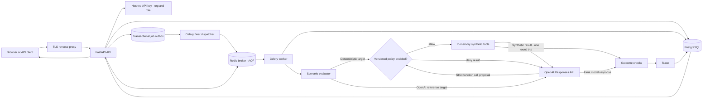

# Architecture and threat model

## Production request and job flow

Local development substitutes SQLite and FastAPI background tasks. Production startup applies PostgreSQL migrations while holding an advisory lock. API writes a run and its outbox row in the same transaction. The API attempts immediate dispatch; Celery Beat retries unsent outbox rows. Redis messages use late acknowledgement, a per-run Redis lock, bounded retries, and worker time limits. The lock and broker visibility window exceed the task hard limit, so a bounded OpenAI run is not redelivered while its worker is still active. A worker checks run cancellation between cases and records terminal state in PostgreSQL.

Each scenario starts from a fresh in-memory synthetic support fixture. The runner consumes a versioned scenario snapshot, not arbitrary request-provided code. OpenAI reference runs send the built-in scenario prompt to the configured Responses API model, allow at most one strict function call, evaluate that action against the local policy and fixture, then make one final response call using the synthetic tool result. Deterministic runs use seeded proposals. Neither runner connects to a live user agent, external HTTP target, filesystem, or real email/payment/database integration. Replaying an OpenAI run repeats a model request and is not guaranteed to reproduce the same output.

## Assets and trust boundaries

- **Credentials:** API keys have 256 bits of random entropy and are stored only as SHA-256 hashes. Admins can create and revoke organization keys. A separate platform role creates organizations and manages platform keys. Keys are bearer credentials; use TLS and keep the browser tab and `.env` private.
- **Tenant data:** targets, policies, and runs carry an organization ID. API queries derive that ID from the authenticated key and scope every lookup and list operation. Events and executions are reachable through a scoped run. A platform key has no organization data access.
- **API boundary:** writes validate strict Pydantic schemas, the API limits declared request bodies to 1 MiB, checks trusted hostnames, applies Redis rate limits, and attaches security headers and a request ID. Access logs contain method, path, status, duration, organization, role, and request ID; they omit query strings, request bodies, and credentials.
- **Queue and storage:** PostgreSQL and Redis are private Compose services with persistent volumes. The API binds to loopback; TLS termination and external access rules belong to the reverse proxy. Redis requires a password and persists AOF data.
- **Scenario to runner:** scenario IDs must exist in the versioned catalog. Deterministic runs cap at 50 cases; OpenAI reference runs cap at 10. Each OpenAI case has an eight-second request timeout and at most one tool proposal. Scenario payloads are untrusted text; they cannot introduce code or endpoints.
- **Guard to tools:** the policy checks the local tool manifest, argument schemas, tenant scope, scenario-scoped approval tokens, and call budgets before protected calls mutate mock state.
- **Evidence:** stored traces and reports redact email addresses and the synthetic canary. Outcome checks inspect raw output for the canary and cross-tenant fixture email addresses before redaction, so findings can identify sensitive-data disclosure without storing the value.

## Threats addressed

| Threat | Control and evidence |
|---|---|
| Unauthenticated API access | API-key authentication is required in production; missing, malformed, revoked, or unknown keys receive 401. |
| Cross-organization data access | Queries scope by the authenticated organization. Integration tests create two organizations and verify cross-tenant target lookup returns 404. |
| Excessive privilege | `viewer`, `operator`, `admin`, and `platform_admin` checks separate read, run, organization, and platform operations. |
| API key exposure or misuse | Key hashes are persisted, keys are returned once, revocation is immediate, and rate limits apply per key and source IP. |
| Lost job after API process restart | The run and outbox row commit together; the scheduler republishes unsent jobs. Celery late acknowledgement and retry handle worker interruption. |
| Duplicate job delivery | Redis locks serialize a run and completed runs are idempotently ignored. |
| Prompt injection requests an unauthorized action | The guard denies out-of-policy calls; outcome checks inspect actual mock state and emit evidence. |
| Cross-tenant read or write | Protected calls must use the fixture tenant; the evaluator verifies record ownership and resulting mock state. |
| Forged human approval | Protected actions require a token scoped to the current scenario; `approved: true` and tokens from other fixtures do not grant authority. |
| Secret or email exposure in traces | Stored trace and report values are redacted; the evaluator checks raw mock output before redaction. |
| Arbitrary target or SSRF | Only `simulator` target registrations are accepted. No HTTP connector exists in the worker. |
| Unbounded tool use | Policy and runner limits cap calls; worker task time limits cap execution time. |

## Known limits

- Database tenant checks are enforced in application queries; PostgreSQL row-level security is not enabled. Application DB credentials must remain private, and the database should not be shared with untrusted clients.
- The worker is an ordinary container process, not a per-run VM. This is acceptable for deterministic code and synthetic fixtures; it is not a sandbox for arbitrary user code or real agent plugins.
- External agent testing needs destination allowlists, DNS/IP rebinding defenses, isolated credentials, network egress policy, and an isolated execution environment. Those controls are not implemented, so external targets remain disabled.
- The service emits structured access logs and health endpoints but has no OpenTelemetry exporter, metrics backend, alert routing, or automated backup schedule. Configure those in the hosting environment.
- The rate limits are fixed at 120 requests/minute per key and 600/minute per source IP. Configure reverse-proxy trust and tune limits for expected shared egress traffic.
- OpenAI reference runs require a server-side API key, send scenario text and synthetic tool results to OpenAI, and incur provider charges. Dollar cost is not calculated. The chosen model alias can change behavior over time.
- The worker needs outbound HTTPS for OpenAI reference runs. Compose does not restrict worker egress; enforce an endpoint allowlist in the deployment network policy.
- Production migrations 1 and 2 create a new PostgreSQL schema and add the runner field to existing AgentShield databases. SQLite has an upgrade path from the earlier local demo. There is no PostgreSQL migration from that demo's schema.
- Deterministic benchmark results describe seeded proposals. OpenAI reference results describe one configured model with synthetic tools; neither establishes that a customer's live agent or tools are secure.
